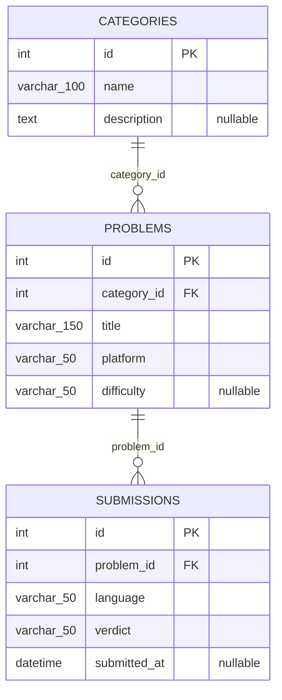

# JANJI
Saya Muhammad Dzaka Indrianto dengan NIM 2508755 mengerjakan Tugas Praktikum 7 dalam mata kuliah Desain dan Pemrograman Berorientasi Objek untuk keberkahanNya maka saya tidak melakukan kecurangan seperti yang telah dispesifikasikan. Aamiin.


# CP Tracker

Website **Competitive Programming Tracker** untuk menyimpan ladder latihan, daftar soal, dan riwayat percobaan penyelesaian soal. Proyek ini dibuat untuk memenuhi Tugas Praktikum 7 mata kuliah Desain dan Pemrograman Berorientasi Objek (DPBO) dengan PHP Native, OOP, MySQL/MariaDB, dan PDO.

## Fitur

- Mengelola kategori atau ladder latihan.
- Mengelola soal, platform, dan tingkat kesulitan.
- Mencatat submission berdasarkan soal, bahasa pemrograman, dan verdict.
- Menampilkan statistik jumlah kategori, soal, dan submission.
- Menolak soal dengan judul dan platform yang sama melalui validasi aplikasi.
- Menggunakan foreign key dengan penghapusan berantai untuk menjaga konsistensi data.

## Teknologi dan kebutuhan

- PHP 8.0 atau lebih baru dengan ekstensi PDO MySQL (`pdo_mysql`).
- MySQL atau MariaDB; dapat dijalankan melalui XAMPP atau Laragon.
- Apache atau PHP built-in server dan browser web.

## Struktur folder

```text
CPTracker/
├── assets/
│   └── style.css                 # Styling halaman
├── class/
│   ├── Category.php              # Model CRUD kategori
│   ├── Problem.php               # Model CRUD soal
│   └── Submission.php            # Model CRUD submission
├── config/
│   ├── bootstrap.php             # Helper tampilan, validasi, session, dan CSRF
│   └── database.php              # Koneksi PDO bersama
├── database/
│   └── db_cptracker.sql          # Struktur tabel, relasi, dan data ekspor/contoh
├── view/
│   ├── category.php              # Antarmuka CRUD kategori
│   ├── problem.php               # Antarmuka CRUD soal
│   └── submission.php            # Antarmuka CRUD submission
├── index.php                     # Dashboard dan statistik
└── README.md
```

## Database

Database aplikasi bernama `db_cptracker` dan memiliki tiga tabel:

| Tabel | Kolom utama | Kegunaan |
|---|---|---|
| `categories` | `id` (PK), `name`, `description` | Menyimpan kategori atau ladder latihan. |
| `problems` | `id` (PK), `category_id` (FK), `title`, `platform`, `difficulty` | Menyimpan soal dan kategori tempat soal tersebut dikelompokkan. |
| `submissions` | `id` (PK), `problem_id` (FK), `language`, `verdict`, `submitted_at` | Menyimpan riwayat percobaan untuk soal. |

### Relasi

- `problems.category_id` mengacu ke `categories.id`. Satu kategori dapat memiliki nol atau banyak soal; setiap soal terhubung ke satu kategori.
- `submissions.problem_id` mengacu ke `problems.id`. Satu soal dapat memiliki nol atau banyak submission; setiap submission terhubung ke satu soal.
- Kedua foreign key menggunakan `ON DELETE CASCADE`. Menghapus kategori akan menghapus soal terkait dan submission dari soal tersebut. Menghapus soal akan menghapus seluruh submission terkait.

### Diagram ERD



## Flow aplikasi

1. Browser mengirim request ke `index.php` atau salah satu halaman di `view/`.
2. Halaman memuat helper `config/bootstrap.php` dan model yang diperlukan dari folder `class/`.
3. Model memperoleh koneksi PDO dari `config/database.php`.
4. Untuk request POST, halaman memeriksa token CSRF dan memvalidasi input.
5. Model menjalankan operasi database dengan PDO prepared statement (`prepare()` dan `execute()`). Nilai dari pengguna dikirim sebagai parameter, bukan digabung ke string SQL.
6. Setelah perubahan berhasil, halaman melakukan redirect (pola Post/Redirect/Get) agar refresh tidak mengirim ulang form.
7. Data dibaca kembali oleh halaman, lalu nilai yang ditampilkan di-escape sebagai HTML.

Alur relasi data saat penggunaan adalah **buat kategori → tambahkan soal ke kategori → catat submission untuk soal**. Kategori perlu dibuat sebelum soal, dan soal perlu tersedia sebelum submission.

## Instalasi dan menjalankan aplikasi

1. Pastikan XAMPP/Laragon memiliki PHP 8+, MySQL/MariaDB, dan ekstensi PDO MySQL aktif.
2. Salin folder proyek ke direktori web server, misalnya `C:\xampp\htdocs\CPTracker` pada XAMPP.
3. Jalankan Apache dan MySQL dari control panel.
4. Buka phpMyAdmin, pilih database `db_cptracker` atau buat database tersebut, lalu impor `database/db_cptracker.sql`.
   - File SQL adalah ekspor database proyek dan berisi definisi tiga tabel, relasi, serta data yang diekspor.
   - Jika mengimpor ke database yang sudah berisi tabel, buat cadangan dahulu. Dump ekspor dapat berisi perintah pembuatan ulang tabel.
5. Buka `config/database.php`. Nilai bawaan adalah host `localhost`, database `db_cptracker`, username `root`, dan password kosong. Sesuaikan dengan konfigurasi MySQL lokal jika berbeda.
6. Buka aplikasi melalui `http://localhost/CPTracker/`.

Jika menggunakan PHP built-in server, jalankan perintah dari direktori proyek:

```bash
php -S localhost:8000
```

Lalu buka `http://localhost:8000/` di browser. MySQL/MariaDB tetap harus berjalan.

## Cara mencoba CRUD

### Kategori

1. Buka menu **Kategori**.
2. Tambahkan kategori, misalnya `Codeforces Div. 2`.
3. Pastikan kategori muncul pada tabel.
4. Pilih **Edit**, ubah nama atau deskripsi, lalu simpan.
5. Pilih **Hapus** untuk menghapus kategori. Soal dan submission turunannya ikut terhapus karena cascade.

### Soal

1. Pastikan minimal satu kategori tersedia.
2. Buka menu **Soal**, pilih kategori, lalu isi judul, platform, dan kesulitan.
3. Pastikan soal muncul dengan nama kategori yang benar.
4. Coba edit dan hapus soal.
5. Aplikasi menolak penambahan judul yang sama pada platform yang sama. Untuk menjaga aturan ini pada level database juga, tambahkan indeks unik seperti di bagian berikut.

### Submission

1. Pastikan minimal satu soal tersedia.
2. Buka menu **Submission**, pilih soal, bahasa, dan verdict.
3. Pastikan submission muncul dengan judul soal dan waktu submit.
4. Coba edit bahasa/verdict atau soal yang dipilih, kemudian coba hapus submission.

## Mencegah soal duplikat pada database

Halaman soal sudah memeriksa pasangan judul dan platform sebelum menyimpan. Untuk menegakkan aturan yang sama pada database, periksa dulu apakah ada duplikat:

```sql
SELECT title, platform, COUNT(*) AS jumlah
FROM problems
GROUP BY title, platform
HAVING COUNT(*) > 1;
```

Jika hasil pemeriksaan kosong, jalankan:

```sql
ALTER TABLE problems
ADD CONSTRAINT uq_problems_title_platform UNIQUE (title, platform);
```

Jika query pemeriksaan menemukan duplikat, tinjau dan rapikan record tersebut terlebih dahulu. Periksa submission yang terkait sebelum menghapus soal duplikat.

## Keamanan dan alur database

- Semua query database aplikasi menggunakan PDO prepared statement.
- Token CSRF diverifikasi untuk operasi POST.
- Input teks divalidasi sebelum dikirim ke model.
- Output teks di-escape saat dirender untuk mencegah injeksi HTML/script.
- Penghapusan record terkait mengikuti aturan foreign key cascade.

## Dokumentasi pengujian (screen record)

Rekam pengujian tambah, baca, edit, dan hapus untuk **kategori, soal, dan submission**, lalu ganti placeholder berikut dengan tautan video yang dapat diakses pemeriksa:

**Tautan screen record:** `[tempel tautan video di sini]`

## Repository pengumpulan

Unggah seluruh folder proyek, termasuk `database/db_cptracker.sql` dan README ini, ke repository GitHub publik dengan format nama `TP7DPBO2526C..` sesuai kelas/kelompok. Setelah repository publik dan screen record siap, kirim tautan repository melalui form pengumpulan yang diberikan pada instruksi tugas.
